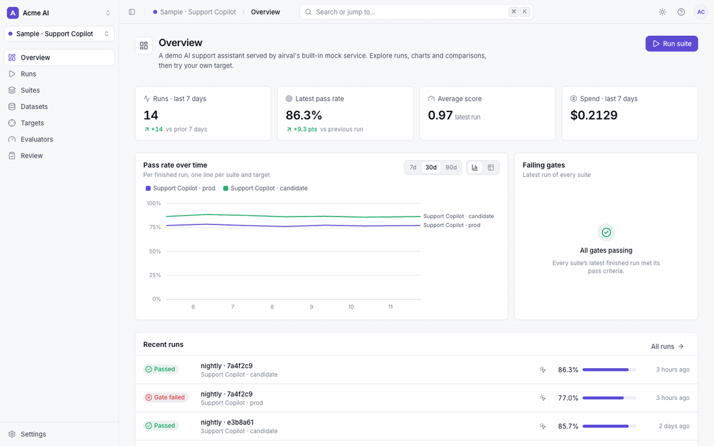
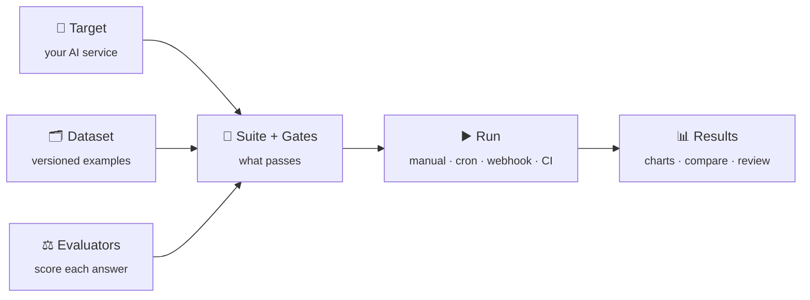
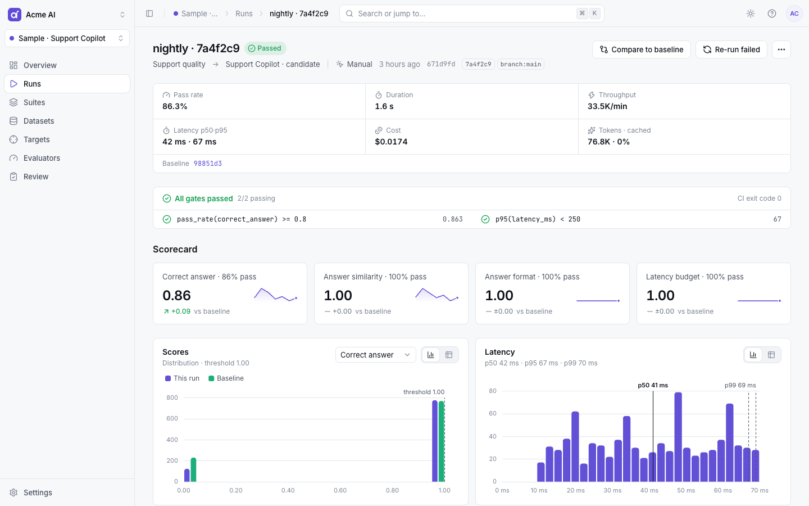
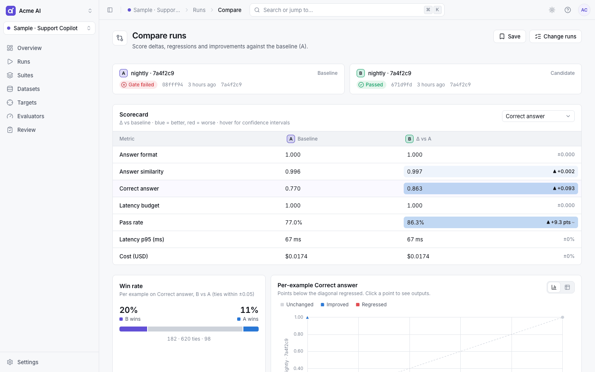
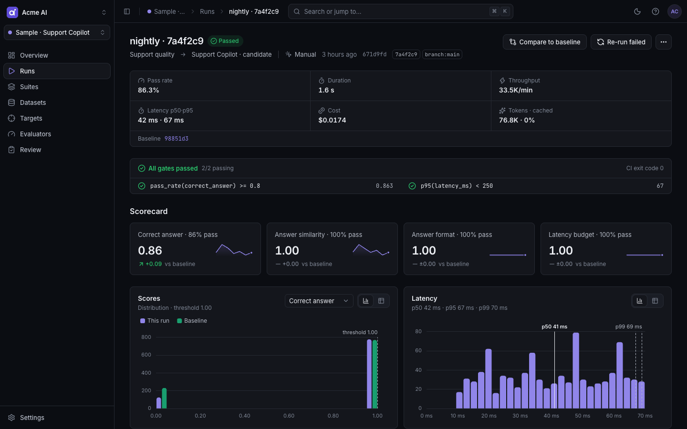
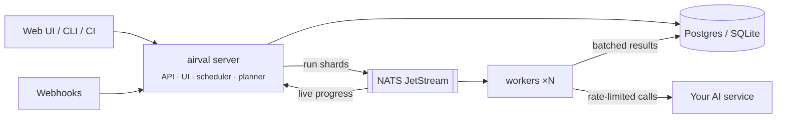

<div align="center">

<a href="https://github.com/prat31/airval">
  <picture>
    <source media="(prefers-color-scheme: dark)" srcset="docs/assets/logo-wordmark-dark.png">
    
  </picture>
</a>

<br>
<br>

**Self-hosted evaluation for AI services.**
Test your LLM apps, RAG pipelines and agents against real datasets. Score every answer, gate every release,
and see exactly what changed.

[](https://github.com/prat31/airval/actions/workflows/ci.yml)
[](go.mod)
[](LICENSE)

[Quickstart](#quickstart) · [How it works](#how-it-works) · [Docs](docs/README.md) · [Deploy](#deploy-anywhere) · [CI](#gate-releases-in-ci)

<br>



</div>

<br>

## Why airval

Shipping an AI feature is easy. Knowing whether this week's prompt, model or retrieval change made it **better or worse**
is not. airval turns that question into a repeatable, fast and visual answer:

- **Evaluate anything that answers questions**: any HTTP API, OpenAI-compatible endpoints, Anthropic, Bedrock and
  Vertex/Gemini, RAG pipelines, tool-calling agents, and multi-turn chat with scripted or LLM-simulated users.
- **Score it like you mean it**: 38 built-in evaluators, from exact match, JSON Schema, latency and tool-call checks
  to LLM judges for correctness, faithfulness and helpfulness, plus pairwise comparison and human review queues.
- **Decide with gates, not vibes**: `pass_rate(correctness) >= 0.9 and p95(latency_ms) < 2000`. Gates turn a run into a
  pass or fail and a CI exit code.
- **See what changed**: live run pages, score distributions, latency percentiles, pass rate by tag, and
  example-by-example comparisons against a baseline.
- **Fast by design**: about 590,000 examples per minute through the engine with 0.03 ms of overhead per example. Real
  runs are bound by your service's rate limits, and adaptive concurrency gets close to them without tripping errors.
- **Yours to run**: one static binary, a Docker image or a Helm chart. Your data, prompts and keys stay on your
  infrastructure.

## Quickstart

Run everything in one process, with no database or queue to set up:

```sh
git clone https://github.com/prat31/airval && cd airval
make build
./bin/airval dev
```

Open **http://localhost:8080**, create your account, and click **Load sample project**. In a few seconds you get a support
copilot with 1,000 examples, four evaluators, gates and two finished runs to explore. No API keys are needed; it runs
against a built-in mock AI service.

> Prefer containers? `cd deploy/docker && cp .env.example .env`, fill in the two required values, and run
> `docker compose --profile mocktarget up -d --build`. See [Deploy anywhere](#deploy-anywhere).

## How it works



| Concept | What it is |
|---|---|
| **Project** | One AI service under evaluation. It owns everything below. |
| **Target** | How airval calls your service (HTTP, OpenAI-compatible, Anthropic, Bedrock, Vertex, agent). Add several to compare prod vs staging or model A vs B. |
| **Dataset** | Examples: input, expected answer, context, tags, or a whole conversation. Import CSV, JSONL, JSON, Parquet or Hugging Face. Every publish is an immutable version. |
| **Evaluator** | Turns an answer into a score from 0 to 1, with a threshold and a severity. Deterministic, LLM judge or human. |
| **Suite** | Targets + dataset + evaluators + execution settings (trials, sampling, concurrency, caching). |
| **Gate** | The pass/fail rule for a run, e.g. `pass_rate(correctness) >= 0.9`. |
| **Run** | One execution of a suite against a target, compared with a **baseline** run. |

### Example: an agent that speaks the OpenAI API

**1. Add a target.** Choose the `openai` kind and point it at your agent:

```json
{
  "base_url": "https://agent.example.com/v1",
  "model": "support-agent",
  "api_key": "{{ secret \"AGENT_KEY\" }}",
  "user_template": "{{ .input.question }}"
}
```

**Test connection** shows the rendered request (keys redacted), the raw response and what airval extracted from it:
the answer, tool calls, token usage and cost.

**2. Import a dataset:**

```jsonl
{"question": "How do I reset my password?", "expected": "Use \"Forgot password\" on the sign-in page.", "tags": ["account"]}
{"question": "Cancel order #123", "expected_tool": "cancel_order", "tags": ["orders"]}
```

**3. Pick evaluators and a gate.** For example `correctness` (an LLM judge), `tool_called` and `latency_ms`, gated on:

```
pass_rate(correctness) >= 0.9 and p95(latency_ms) < 3000 and count(critical_fail) == 0
```

**4. Run it** from the UI, on a schedule, from a deploy webhook, or from CI. Then open the run to see every answer
side by side with what was expected, along with each judge's reasoning.

## Screenshots

<table>
  <tr>
    <td width="50%"></td>
    <td width="50%"></td>
  </tr>
  <tr>
    <td align="center"><sub><b>Run detail</b>: gates, scorecards vs baseline, distributions, results</sub></td>
    <td align="center"><sub><b>Compare</b>: deltas with confidence intervals, win rate, per-example regressions</sub></td>
  </tr>
  <tr>
    <td colspan="2"></td>
  </tr>
  <tr>
    <td colspan="2" align="center"><sub>Light and dark themes, keyboard-first navigation (<kbd>⌘</kbd> <kbd>K</kbd>), and every view shareable by URL</sub></td>
  </tr>
</table>

## Features

<table>
<tr>
<td valign="top" width="50%">

**Targets**
- HTTP with request templates and JSONPath response mapping
- OpenAI-compatible, Anthropic, Bedrock (SigV4), Vertex/Gemini
- Streaming (SSE / NDJSON) with time-to-first-token
- Agents: tool calls and intermediate trace steps
- Multi-turn: scripted conversations or an LLM-simulated user
- Encrypted secrets, SSRF guard, mTLS

**Datasets**
- Import CSV, JSONL, JSON, Parquet, Hugging Face
- Spreadsheet editor, tags, search, bulk edit
- Immutable versions with diffs
- Add any failed result back to a dataset in one click

**Evaluators**
- Exact, contains, regex, JSON Schema, JSONPath, numeric
- Levenshtein, ROUGE-L, BLEU, embedding similarity
- Latency, cost, tokens, PII and refusal detection
- Tool called / tool sequence for agents
- LLM judges: correctness, faithfulness, relevance, hallucination, toxicity, conversation goal and more
- Pairwise vs baseline with position swap, N-sample voting
- Human review queues, with judge–human agreement (Cohen's κ)

</td>
<td valign="top" width="50%">

**Runs**
- Manual, cron schedules, signed webhooks, API and CLI
- Sampling (random or stratified), trials with pass@k
- Response and judge caching; re-score old runs at zero cost
- Re-run only the failures
- Early stop on a failure budget
- Live progress over server-sent events

**Analysis**
- Scorecards against a baseline with sparklines
- Score histograms, latency p50/p95/p99, pass rate by tag
- Evaluator × tag heatmap, cost and token breakdown
- Run comparison with bootstrap confidence intervals
- Trends across runs, per suite and target

**Operations**
- Organizations, projects, roles (owner, admin, editor, viewer)
- API keys for CI, Slack / webhook / email notifications
- Prometheus metrics, OpenTelemetry traces, structured logs
- SQLite for single-node use, Postgres for production
- NATS JetStream work queue; workers scale horizontally

</td>
</tr>
</table>

## Gate releases in CI

```sh
airval run --suite support-quality --target <target-id> --gate --markdown
```

The command exits non-zero when a gate fails and prints a Markdown summary ready for a PR comment. On GitHub, the
bundled action does both:

```yaml
- uses: prat31/airval/.github/actions/airval-run@main
  with:
    server-url: https://airval.example.com
    api-key: ${{ secrets.AIRVAL_API_KEY }}
    suite: support-quality
    project: <project-id>
```

JUnit output (`--junit`), sampling for fast PR checks (`--sample`) and labels such as `git_sha` are supported too.
See [docs/ci.md](docs/ci.md).

## Deploy anywhere

| | Command | Best for |
|---|---|---|
| **Binary** | `airval dev` | Laptops and single servers. SQLite and NATS are embedded. |
| **Docker Compose** | `docker compose up -d` in [`deploy/docker`](deploy/docker) | A production-shaped stack: Postgres 17, NATS JetStream, server and 2 workers |
| **Kubernetes** | `helm install airval deploy/helm/airval` | Production. Autoscaling workers (HPA or KEDA), PDBs, migrations as a hook |

<details>
<summary><b>Docker Compose</b></summary>

```sh
cd deploy/docker && cp .env.example .env
# Set AIRVAL_SECRETS_MASTER_KEY (openssl rand -base64 32)
# and POSTGRES_PASSWORD (URL-safe, e.g. openssl rand -hex 24)
docker compose --profile mocktarget up -d --build   # http://localhost:8080
docker compose up -d --scale worker=4               # scale out workers
```

Set `AIRVAL_SERVER_MOCK_TARGET=true` in `.env` to enable the one-click sample project.
</details>

<details>
<summary><b>Kubernetes (Helm)</b></summary>

```sh
helm dependency build deploy/helm/airval
helm install airval deploy/helm/airval -n airval --create-namespace \
  --set postgresql.external.url='postgres://user:pass@db:5432/airval?sslmode=require' \
  --set config.baseUrl=https://airval.example.com
helm test airval -n airval
```

NATS JetStream is bundled (or use `nats.external.url`). For a quick trial without a database, use
`-f deploy/helm/airval/ci/dev-values.yaml`. See the [chart README](deploy/helm/airval/README.md) for existing
Secrets, KEDA, Gateway API, CloudNativePG and NetworkPolicy options.
</details>

<details>
<summary><b>Server and workers on your own infrastructure</b></summary>

```sh
export AIRVAL_DATABASE_URL=postgres://user:pass@db:5432/airval
export AIRVAL_NATS_URL=nats://nats:4222
export AIRVAL_SECRETS_MASTER_KEY="$(airval secrets gen-key)"
airval migrate up
airval server   # API, UI and scheduler (stateless, scale horizontally)
airval worker   # executes runs (scale horizontally)
```
</details>

All three were verified end to end with real runs; see [deploy/VERIFICATION.md](deploy/VERIFICATION.md).

## Architecture



A run is planned into shards and published to JetStream. Workers call your service through per-target adaptive
rate limiters (AIMD on 429s and `Retry-After`), score answers in a pipelined evaluator stage (LLM judges get their own
pool, so they never block target calls), and write results in batches. A finalizer computes aggregates and gates, and
the UI streams it all live. Details are in [docs/performance.md](docs/performance.md).

## Documentation

| | |
|---|---|
| [Getting started](docs/getting-started.md) | Install, sample project, first run |
| [Concepts](docs/concepts.md) | Projects, targets, datasets, suites, gates, runs |
| [Targets](docs/targets.md) | Every adapter, templating, JSONPath mapping, multi-turn |
| [Evaluators](docs/evaluators.md) · [reference](docs/evaluators-reference.md) | Choosing evaluators, LLM judges, all 38 kinds |
| [Gates](docs/gates.md) | Grammar, functions, failure budgets |
| [Runs](docs/runs.md) · [CI](docs/ci.md) | Triggers, sampling, caching, webhooks, CLI |
| [Deployment](docs/deployment.md) · [Configuration](docs/configuration.md) | Binary, Compose, Helm, every setting |
| [API](docs/api.md) · [Security](docs/security.md) | REST API, events, auth, secrets |

## Editions

airval is **open core**. Everything above is Apache-2.0. The enterprise build (`-tags ee`, in [`ee/`](ee)) adds
OIDC and SAML single sign-on, SCIM provisioning, custom roles with per-project access, an audit log, data retention
policies and branding. See [docs/enterprise.md](docs/enterprise.md).

## Contributing

```sh
make check   # Go vet, gofmt, tests on SQLite and Postgres, web type check, lint and tests
make test-pg # store and API contract tests against Postgres
make bench   # engine throughput benchmark
npm --prefix web run e2e   # Playwright golden path against a real airval dev
```

Start with [AGENTS.md](AGENTS.md) for the project's standards and [docs/contributing.md](docs/contributing.md) for
adding a target adapter or evaluator. The README media is regenerated by `scripts/readme-media/build.sh`.

## License

Core: [Apache-2.0](LICENSE). Enterprise features in `ee/`: [commercial license](LICENSE-EE).
